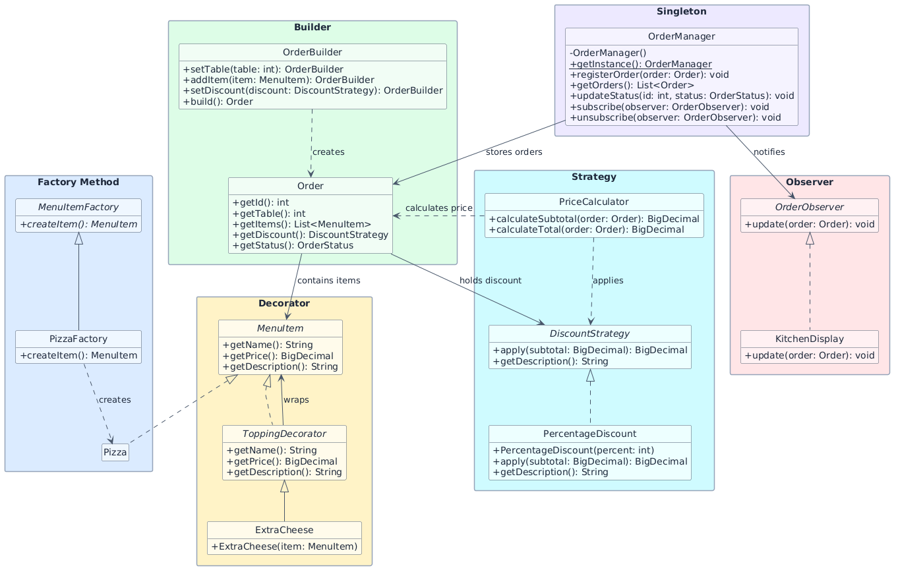
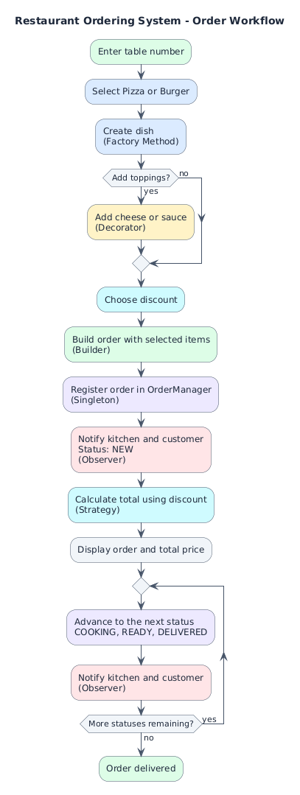
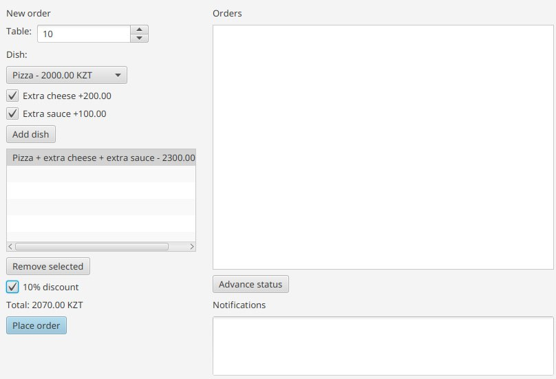
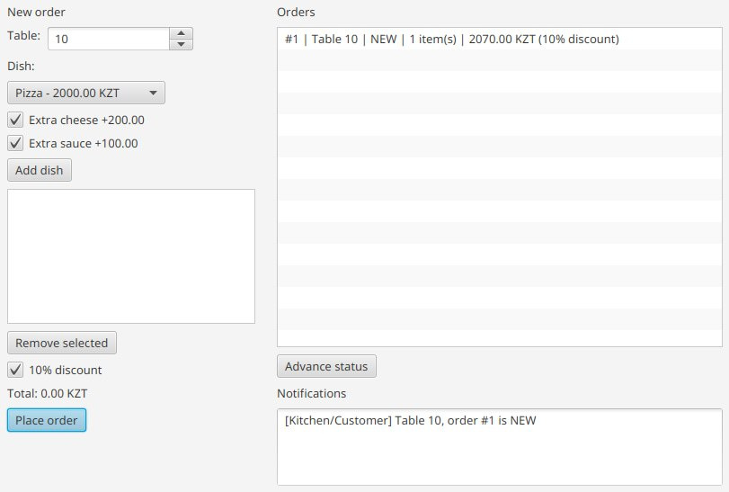
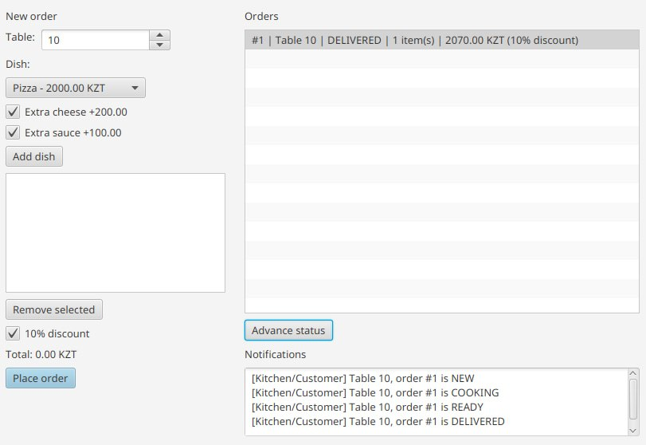
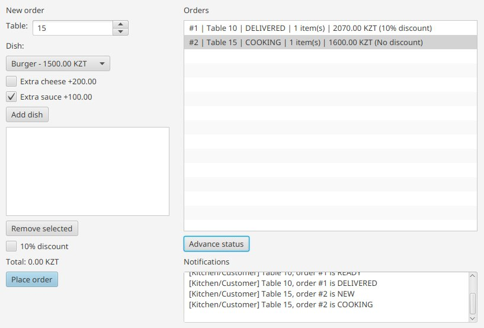

# Final Project - Restaurant Ordering System

**Group:** SE-2539

**Team members:**

- Aldiyar Kairollin
- Ilya Koval
- Aidar Murat

A JavaFX application built with Java 25 and Gradle: order creation,
dish toppings, discounts, and order status notifications.
Orders are stored in memory until the application exits.

## Running the application

From the project root:

```bash
./gradlew :app:run
```


## Building and testing

```bash
./gradlew :app:test :app:build
```

HTML JUnit test report: `app/build/reports/tests/test/index.html`.

HTML JaCoCo coverage report: `app/build/reports/jacoco/test/html/index.html`.


## Design patterns and responsibilities

Group: **SE-2539**.

| Student | Patterns | Files |
| --- | --- | --- |
| Aldiyar Kairollin | Factory Method, Decorator | `menu/`, `menu/factory/`, `menu/decorator/` |
| Ilya Koval | Singleton, Observer | `order/OrderManager.java`, `order/observer/`; also the order model and statuses |
| Aidar Murat | Builder, Strategy | `order/OrderBuilder.java`, `pricing/`, `pricing/strategy/` |

All paths in the table are relative to `app/src/main/java/org/example/`.
`ui/RestaurantFxApp.java` integrates the work of all three students.

## UML diagrams

### Class diagram

Main classes and representative implementations of all six design patterns.



### Activity diagram

Order creation, price calculation, and status notifications.



## Features

- Dishes: Pizza (2000 KZT), Burger (1500 KZT).
- Toppings: extra cheese (+200), extra sauce (+100 KZT).
  Toppings can be combined and repeated.
- Discounts: none or 10%.
- An order can contain multiple dishes. Each order is associated with a table number.
- Statuses: `NEW -> COOKING -> READY -> DELIVERED`.
- The kitchen and customer receive console notifications when an order is registered and whenever its status changes.
- All amounts use `BigDecimal` and are rounded to two decimal places.

## Screenshots

### Main menu

Create orders, view existing orders, advance their status, or exit.



### Order creation

Pizza with extra cheese and a 10% discount totals 1980.00 KZT. The kitchen and customer receive NEW order notifications.



### Order details

View the order ID, table, status, items, subtotal, discount, and total.



### Status update

Advance the order to COOKING and notify both the kitchen and customer.



## Demo scenario

1. Select `1. Create order` and enter table `5`.
2. Choose Pizza and add extra cheese and extra sauce.
3. Enter `0` to finish toppings, then `0` again to finish selecting dishes.
4. Select discount `2. 10%`.
5. Check the kitchen and customer notifications, subtotal of `2300.00 KZT`, and total of `2070.00 KZT`.
6. Select `2. View orders` and note the order ID.
7. Select `3. Advance order status` three times, entering that ID each time:
   `COOKING`, then `READY`, then `DELIVERED`.
8. Select `0. Exit`.
